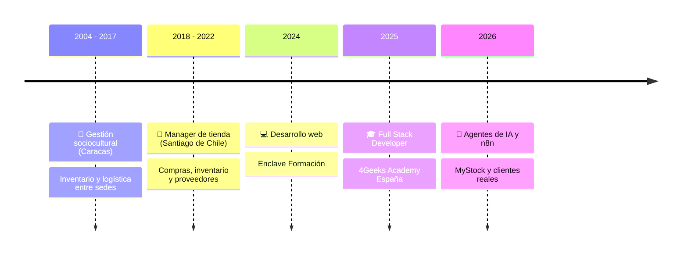

<!-- ============ CABECERA ============ -->
<p align="center">
  
</p>

<p align="center">
  <a href="https://github.com/ErwinGonzalezBonilla">
    
  </a>
</p>

<p align="center">
  <a href="https://www.linkedin.com/in/erwingonzalezbonilla"></a>
  <a href="mailto:alexcultural@gmail.com"></a>
  <a href="https://www.kevinalvamusic.com"></a>
</p>

<p align="center">
  
  
  
  
</p>

<br/>

<!-- ============ CIFRAS ============ -->
<table align="center">
  <tr>
    <td align="center" width="160"><h2>15+</h2><sub>años gestionando<br/>negocios reales</sub></td>
    <td align="center" width="160"><h2>4</h2><sub>webs para<br/>clientes reales</sub></td>
    <td align="center" width="160"><h2>3</h2><sub>proyectos con<br/>IA integrada</sub></td>
    <td align="center" width="160"><h2>411</h2><sub>commits en equipo<br/>(Patitas Club)</sub></td>
  </tr>
</table>

<!-- ============ ÁREAS ============ -->
<table align="center">
  <tr>
    <td align="center" width="25%">🧠<br/><b>Inteligencia Artificial</b><br/><sub>Chatbots y asistentes con OpenAI, Claude y Gemini</sub></td>
    <td align="center" width="25%">⚙️<br/><b>Automatización</b><br/><sub>Agentes y flujos con n8n y Make</sub></td>
    <td align="center" width="25%">💻<br/><b>Desarrollo Web</b><br/><sub>React, Vite, HTML, CSS y JavaScript</sub></td>
    <td align="center" width="25%">🗄️<br/><b>APIs y Bases de Datos</b><br/><sub>FastAPI, Flask, Node y PostgreSQL</sub></td>
  </tr>
</table>


## 👨‍💻 Sobre mí

Construyo aplicaciones web con **React y Python** y les integro **IA**: chatbots con la API de OpenAI, agentes y flujos automatizados con **n8n**.

Antes de programar pasé **más de 15 años gestionando inventario, compras, proveedores y equipos** en Venezuela y Chile. Por eso diseño software pensando en cómo trabaja de verdad un negocio, no solo en cómo se ve.

```python
class Erwin:
    rol        = "Full Stack Developer · IA y Automatización"
    base       = "Madrid, España 🇪🇸  (abierto a remoto)"
    formacion  = ["Full Stack · 4Geeks Academy (2025)",
                  "Agentes de IA y n8n (2026)",
                  "AWS Cloud Practitioner (en preparación)"]
    superpoder = "15+ años en compras, stock y proveedores antes de escribir código"
    busco      = "Mi primer rol como developer 🚀"

    def filosofia(self):
        return "Software que resuelve problemas reales de negocio, no solo que se ve bonito."
```


## 🚀 Proyectos destacados

<table>
<tr>
<td colspan="2" valign="top">

### 📦 [MyStock](https://github.com/ErwinGonzalezBonilla/MyStock) &nbsp;  

> **Plataforma SaaS multiempresa** para que pequeños negocios gestionen inventario, punto de venta, compras, ventas, clientes y proveedores desde un solo sitio, con un **asistente de IA** que sugiere qué reponer.

| 🏗️ Arquitectura | 🔐 Seguridad | 📚 Producto | 💡 Origen |
|:---|:---|:---|:---|
| React → FastAPI → SQLAlchemy → PostgreSQL → IA → n8n | Multi-tenant con autenticación JWT | Docs, roadmap, changelog y guía de contribución | Años gestionando el stock de una tienda |

    

<a href="https://github.com/ErwinGonzalezBonilla/MyStock"></a>

</td>
</tr>
<tr>
<td width="50%" valign="top">

### 🎤 [Kevin Alva · Web y entradas](https://github.com/ErwinGonzalezBonilla/kevin-alva-web)
 

Web oficial de un artista musical con agenda, discografía, Spotify y YouTube, y un **sistema de venta de entradas**:

💳 El fan paga con **Stripe** → 🎟️ recibe una entrada con **QR firmado (HMAC-SHA256)** → 📱 en la puerta se valida con la cámara del móvil.

     

<a href="https://www.kevinalvamusic.com"></a>
<a href="https://github.com/ErwinGonzalezBonilla/kevin-alva-web"></a>

</td>
<td width="50%" valign="top">

### 🎈 [Ballonette](https://github.com/ErwinGonzalezBonilla/ballonette-react)
 

Web para una empresa de decoración de eventos en Madrid:

🖼️ Galería por categorías con rutas dinámicas<br/>
🛠️ **Panel de administración** que sube fotos a **Cloudinary**<br/>
🤖 **BalloonBot**, un chatbot con OpenAI que atiende a los clientes

    

<a href="https://ballonette-react.vercel.app"></a>
<a href="https://github.com/ErwinGonzalezBonilla/ballonette-react"></a>

</td>
</tr>
<tr>
<td width="50%" valign="top">

### 🐾 [Patitas Club](https://github.com/4GeeksAcademy/PatitasClub)
 

E-commerce de productos para mascotas, proyecto final del bootcamp:

⚛️ Frontend en React · 🐍 **API REST en Flask**<br/>
🔐 Login con **JWT** · 🗃️ Modelos con SQLAlchemy<br/>
💳 **Pagos con Stripe** · 🤝 Ramas, PRs e issues en equipo

    

<a href="https://github.com/4GeeksAcademy/PatitasClub"></a>

</td>
<td width="50%" valign="top">

### 💌 [Generador de invitaciones](https://github.com/ErwinGonzalezBonilla/generador-invitaciones)
 

Convertí una invitación hecha para un cliente en una **herramienta pública**:

✍️ Rellenas los datos → 👀 vista previa en directo → 📲 compartes por WhatsApp.<br/>
⚡ **Sin backend**: toda la invitación viaja en la URL.

   

<a href="https://generador-invitaciones.vercel.app"></a>
<a href="https://github.com/ErwinGonzalezBonilla/generador-invitaciones"></a>

</td>
</tr>
<tr>
<td colspan="2" valign="top">

### 🐶 Don Dog · Tienda online &nbsp;  

Tienda online para un pet shop: catálogo con filtros, carrito y checkout, **panel de administración con control de stock y pedidos** y **"El Don"** 🤖, un asistente de IA que recomienda productos según la mascota y lo que hay en stock.

</td>
</tr>
</table>


## 🛠️ Stack técnico

<table align="center">
  <tr>
    <td align="center"><b>🎨 Frontend</b></td>
    <td></td>
  </tr>
  <tr>
    <td align="center"><b>🐍 Backend</b></td>
    <td></td>
  </tr>
  <tr>
    <td align="center"><b>🗄️ Datos</b></td>
    <td></td>
  </tr>
  <tr>
    <td align="center"><b>🚢 Herramientas</b></td>
    <td></td>
  </tr>
  <tr>
    <td align="center"><b>🤖 IA y automatización</b></td>
    <td>
      
      
      
      
      
    </td>
  </tr>
  <tr>
    <td align="center"><b>☁️ Servicios</b></td>
    <td>
      
      
    </td>
  </tr>
</table>


## 🧭 Trayectoria



<p align="center">
  <i>"Gestioné el stock de una tienda durante cuatro años.<br/>Ahora construyo el software que me habría gustado tener."</i>
</p>


## 📊 Actividad en GitHub

<p align="center">
  
  
</p>

<p align="center">
  
</p>

<p align="center">
  
</p>

<!-- Serpiente de contribuciones: requiere el workflow .github/workflows/snake.yml -->
<p align="center">
  <picture>
    <source media="(prefers-color-scheme: dark)" srcset="https://raw.githubusercontent.com/ErwinGonzalezBonilla/ErwinGonzalezBonilla/output/github-snake-dark.svg"/>
    
  </picture>
</p>


## 🌱 Ahora mismo

| | |
|:---:|:---|
| 🚀 | Lanzando la nueva web de **Kevin Alva** |
| 📦 | Construyendo **MyStock** paso a paso |
| ☁️ | Preparando la certificación **AWS Cloud Practitioner** |
| 🤝 | Buscando mi **primer rol como developer** |

<br/>

<p align="center">
  <b>¿Tienes un proyecto o una vacante? ¡Hablemos! 👇</b><br/><br/>
  <a href="https://www.linkedin.com/in/erwingonzalezbonilla"></a>
  <a href="mailto:alexcultural@gmail.com"></a>
</p>

<p align="center">
  
</p>

