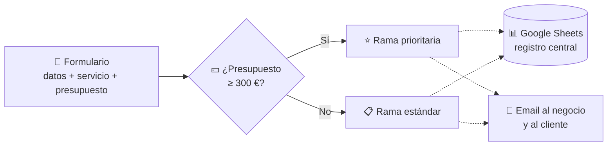

<!-- ═══════════════ CABECERA ═══════════════ -->


<p align="center">
  
</p>

<p align="center">
  <a href="https://portafolio-erwin.vercel.app/"></a>
  <a href="https://www.linkedin.com/in/erwingonzalezbonilla"></a>
  <a href="mailto:alexcultural@gmail.com"></a>
  <a href="https://www.kevinalvamusic.com"></a>
  
</p>

<!-- ═══════════════ FICHA DEL ROBOT ═══════════════ -->
<table align="center">
<tr>
<td width="38%" align="center">
  
</td>
<td width="62%" valign="middle">

```yaml
unidad:      ERWIN-01
modelo:      Automatización con n8n e IA · Full Stack Developer
base:        Madrid, España 🇪🇸  (remoto ✔)
estado:      🟢 ONLINE · disponible para trabajar
portafolio:  portafolio-erwin.vercel.app
idiomas:     [español: nativo, inglés: B1]
especialidad:
  - Flujos de automatización con n8n y Make
  - Integración de IA (OpenAI, Claude, Gemini) en procesos reales
  - Webs y APIs con React + Python
experiencia_previa:
  - 15+ años en inventario, compras y proveedores
  - Caracas 🇻🇪 → Santiago 🇨🇱 → Madrid 🇪🇸
mision:      "Automatizar el trabajo repetitivo de los negocios"
```

</td>
</tr>
</table>

<!-- ═══════════════ PANEL DE SISTEMA ═══════════════ -->
<table align="center">
  <tr>
    <td align="center" width="170">🔋<br/><h3>15+</h3><sub>AÑOS EN<br/>NEGOCIOS REALES</sub></td>
    <td align="center" width="170">🛰️<br/><h3>4</h3><sub>WEBS PARA<br/>CLIENTES</sub></td>
    <td align="center" width="170">🧠<br/><h3>3</h3><sub>PROYECTOS<br/>CON IA</sub></td>
    <td align="center" width="170">⚙️<br/><h3>411</h3><sub>COMMITS<br/>EN EQUIPO</sub></td>
  </tr>
</table>


##  Protocolos de automatización

> Pasé 15 años haciendo a mano tareas que hoy sé automatizar. Ahora construyo los flujos que me habría gustado tener: **recibir, clasificar, registrar y notificar sin intervención humana**.

<table>
<tr>
<td width="33%" valign="top" align="center">

### 🔁 Flujos con n8n
<sub>Diseño workflows que conectan formularios, hojas de cálculo, email y APIs, con reglas de negocio y ramas condicionales.</sub>

</td>
<td width="33%" valign="top" align="center">

### 🧠 IA aplicada
<sub>Integro modelos de OpenAI, Claude y Gemini para atender clientes, recomendar productos y sugerir decisiones.</sub>

</td>
<td width="33%" valign="top" align="center">

### 🔌 Integraciones
<sub>Google Sheets, Gmail, Stripe, Cloudinary y webhooks, unidos en un solo flujo de datos controlado.</sub>

</td>
</tr>
</table>


##  Registro de actualizaciones

<table>
<tr>
<td width="33%" valign="top" align="center">

### 🏪 v1.0
**ANTES**

<sub>15+ años gestionando inventario, compras, proveedores y equipos en Caracas y Santiago. Calibrado con datos reales de negocio.</sub>

</td>
<td width="33%" valign="top" align="center">

### 🤖 v2.0
**AHORA**

<sub>Automatizo procesos con <b>n8n</b>, integro <b>IA</b> y construyo webs con React y Python. Instalado en 4Geeks Academy (2025).</sub>

</td>
<td width="33%" valign="top" align="center">

### 🚀 v3.0
**PRÓXIMO**

<sub>Objetivo: <b>primer rol en automatización / developer</b>.<br/>Descargando AWS Cloud Practitioner…</sub><br/>
`▓▓▓▓▓▓▓░░░ 70%`

</td>
</tr>
</table>


##  Misiones

### ⚡ [Automatización de solicitudes de clientes](https://github.com/ErwinGonzalezBonilla/n8n-gestion-solicitudes-clientes) &nbsp;  

> Un flujo en **n8n** que elimina el trabajo manual de recibir, revisar y organizar las solicitudes de clientes.



<sub>Línea continua: funcionando y probado con datos de prueba · Línea punteada: integración en curso</sub>

| 🎯 Objetivo | 🧩 Lógica | 🧪 Estado |
|:---|:---|:---|
| Reducir el trabajo manual de gestionar solicitudes | Nodo **IF** con regla de negocio por presupuesto (≥ 300 €) | Formulario y clasificación validados con datos de prueba |
| Centralizar el registro | **Google Sheets** como base de datos de solicitudes | Arquitectura preparada, integración en curso |
| Respuesta inmediata | **Notificaciones por email** al negocio y al cliente | Integración en curso + pruebas end-to-end |

**¿Por qué n8n?** Permite conectar servicios de forma visual, controlar el flujo de datos y construir integraciones sin programar toda la lógica desde cero. Proyecto versionado en GitHub y documentado para su mantenimiento.

   

[📂 **Ver repositorio →**](https://github.com/ErwinGonzalezBonilla/n8n-gestion-solicitudes-clientes)

<br/>

<table>
<tr>
<td colspan="2" valign="top">

### 📦 [MyStock](https://github.com/ErwinGonzalezBonilla/MyStock) &nbsp;  

> El software que me habría gustado tener en la tienda: **inventario, punto de venta, compras, clientes y proveedores** en un solo sitio, con un 🤖 **asistente de IA** que sugiere qué reponer y **automatizaciones con n8n** para las tareas repetitivas.

| 🏗️ Arquitectura | 🔐 Seguridad | 📚 Producto |
|:---|:---|:---|
| React → FastAPI → PostgreSQL → IA → n8n | Multi-tenant con JWT | Docs, roadmap y changelog |

    

</td>
</tr>
<tr>
<td colspan="2" valign="top">

### 🐶 Don Dog · Tienda online &nbsp;  

Tienda para un pet shop con catálogo, carrito, 📊 **control de stock y pedidos**, y el bot 🤖 **"El Don"**, que recomienda productos según la mascota y lo que hay en stock.

</td>
</tr>
<tr>
<td width="50%" valign="top">

### 🎈 [Ballonette](https://github.com/ErwinGonzalezBonilla/ballonette-react)
 

Web de eventos con 🖼️ galería, 🛠️ panel de administración y el bot 🤖 **BalloonBot**, que atiende a los clientes con OpenAI.

   

[🌐 **Ver web →**](https://ballonette.com)

</td>
<td width="50%" valign="top">

### 🎤 [Kevin Alva](https://github.com/ErwinGonzalezBonilla/kevin-alva-web)
 

Web de artista con **venta de entradas automatizada**:\
💳 Stripe → 🎟️ QR firmado (HMAC-SHA256) → 📱 validación en puerta.

   

[🌐 **Ver web →**](https://www.kevinalvamusic.com)

</td>
</tr>
<tr>
<td width="50%" valign="top">

### 🐾 [Patitas Club](https://github.com/4GeeksAcademy/PatitasClub)
 

E-commerce para mascotas con API REST en Flask, 🔐 login con JWT y 💳 pagos con Stripe.

   

</td>
<td width="50%" valign="top">

### 💌 [Invitaciones](https://github.com/ErwinGonzalezBonilla/generador-invitaciones)
 

✍️ Rellenas → 👀 vista previa → 📲 WhatsApp.\
⚡ **Sin backend**: toda la invitación viaja en la URL.

  

[🌐 **Crear invitación →**](https://generador-invitaciones.vercel.app)

</td>
</tr>
</table>


##  Componentes instalados

<table align="center">
  <tr>
    <td align="center"><b>⚡ Automatización</b></td>
    <td>
      
      
      
      
      
    </td>
  </tr>
  <tr>
    <td align="center"><b>🧠 Núcleo IA</b></td>
    <td>
      
      
      
    </td>
  </tr>
  <tr>
    <td align="center"><b>🎨 Interfaz</b></td>
    <td></td>
  </tr>
  <tr>
    <td align="center"><b>⚙️ Motor</b></td>
    <td></td>
  </tr>
  <tr>
    <td align="center"><b>💾 Memoria</b></td>
    <td></td>
  </tr>
  <tr>
    <td align="center"><b>🔧 Herramientas</b></td>
    <td></td>
  </tr>
  <tr>
    <td align="center"><b>🔌 Servicios</b></td>
    <td>
      
      
    </td>
  </tr>
</table>


##  Telemetría

<p align="center">
  
  
</p>

<p align="center">
  
</p>


<p align="center">
  <br/>
  <b>📡 TRANSMISIÓN ABIERTA</b><br/>
  <i>¿Tienes un proceso que se repite cada día? Probablemente se puede automatizar. Recibo señal.</i><br/><br/>
  <a href="https://www.linkedin.com/in/erwingonzalezbonilla"></a>
  <a href="mailto:alexcultural@gmail.com"></a>
  <a href="https://portafolio-erwin.vercel.app/"></a>
</p>


I bring 15+ years of experience in inventory, purchasing, suppliers, and
business operations. My goal is to automate repetitive tasks so
businesses can spend less time on manual work and more time growing.

## What I do

-   **n8n workflows:** Connect forms, spreadsheets, email, and APIs
    using business rules and conditional branches.
-   **Applied AI:** Integrate AI models to assist customers, recommend
    products, and support decision-making.
-   **Integrations:** Connect Google Sheets, Gmail, Stripe, Cloudinary,
    and webhooks in controlled data flows.

## Projects

### Customer Request Automation

[GitHub
repository](https://github.com/ErwinGonzalezBonilla/n8n-gestion-solicitudes-clientes)
· In progress

An n8n workflow designed to reduce manual work when receiving,
reviewing, and organizing customer requests.

-   Uses an IF node to classify requests by budget (priority when budget
    is at least €300).
-   Google Sheets is planned as the central request register.
-   Email notifications to the business and customer are being
    integrated.
-   The form and classification logic have been validated with test
    data.

### MyStock

[GitHub repository](https://github.com/ErwinGonzalezBonilla/MyStock) ·
In progress

An inventory and point-of-sale SaaS concept for managing products,
purchasing, customers, and suppliers in one place. The planned product
includes an AI assistant to suggest restocking and n8n automations for
repetitive tasks.

**Architecture:** React → FastAPI → PostgreSQL → AI → n8n\
**Security:** Multi-tenant architecture with JWT\
**Project materials:** Documentation, roadmap, and changelog

### Don Dog · Online pet store

In progress · Real client project

An online pet store with a product catalog, shopping cart, stock and
order management, and an AI bot called **El Don**. The bot recommends
products based on the pet and available stock.

### Ballonette

[GitHub
repository](https://github.com/ErwinGonzalezBonilla/ballonette-react) ·
[Live website](https://ballonette.com)

An events website with a gallery, admin panel, and **BalloonBot**, an AI
chatbot that assists customers using OpenAI.

**Stack:** React, Vite, Cloudinary, OpenAI

### Kevin Alva

[GitHub
repository](https://github.com/ErwinGonzalezBonilla/kevin-alva-web) ·
[Live website](https://www.kevinalvamusic.com)

An artist website with automated ticket sales:

**Stripe → HMAC-SHA256 signed QR code → door validation**

**Stack:** JavaScript, Node.js, Stripe, Vercel

### Patitas Club

[GitHub repository](https://github.com/4GeeksAcademy/PatitasClub) ·
Completed team project

A pet e-commerce platform with a Flask REST API, JWT authentication, and
Stripe payments.

**Stack:** React, Flask, SQLAlchemy, Stripe

### Invitations

[GitHub
repository](https://github.com/ErwinGonzalezBonilla/generador-invitaciones)
· [Live app](https://generador-invitaciones.vercel.app)

A simple invitation generator: fill in the details, preview the
invitation, and share it through WhatsApp. No backend is required; the
invitation data is carried in the URL.

**Stack:** HTML, CSS, JavaScript

## Tech stack

  Area         Technologies
  ------------ -----------------------------------------------
  Automation   n8n, Make, Webhooks, Google Sheets, Gmail
  AI           OpenAI, Claude, Gemini
  Frontend     React, Vite, JavaScript, HTML, CSS, Bootstrap
  Backend      Python, FastAPI, Flask, Node.js
  Databases    PostgreSQL, MySQL
  Tools        Git, GitHub, Vercel, VS Code, Postman
  Services     Stripe, Cloudinary

## Background

-   15+ years of experience in inventory, purchasing, suppliers, and
    business operations.
-   Professional journey across Caracas, Santiago, and Madrid.
-   Full Stack development training at 4Geeks Academy (2025).
-   Current focus: workflow automation, applied AI, and software
    development.

## Let's connect

Have a business process that gets repeated every day? It can probably be
automated.

-   **Portfolio:** https://portafolio-erwin.vercel.app/
-   **LinkedIn:** https://www.linkedin.com/in/erwingonzalezbonilla
-   **Email:** alexcultural@gmail.com
