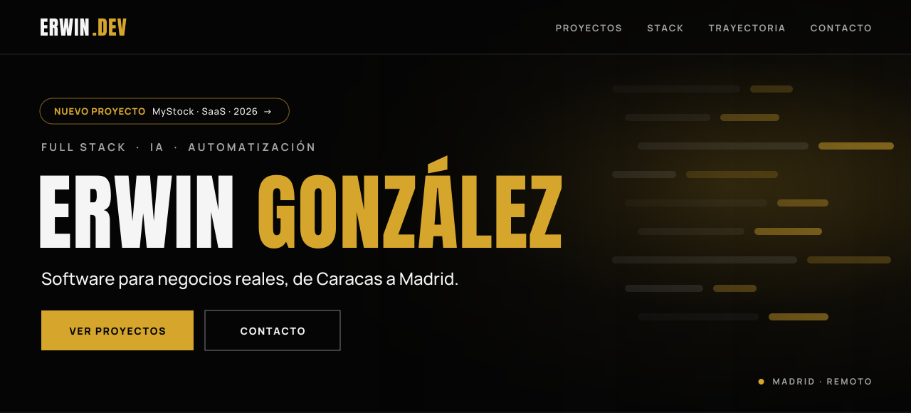
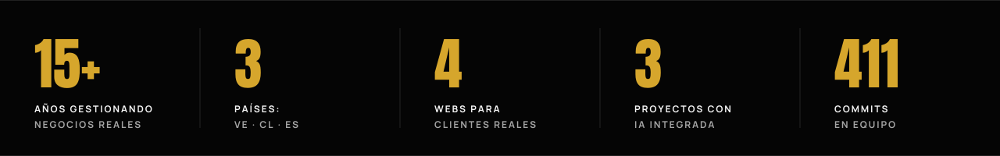
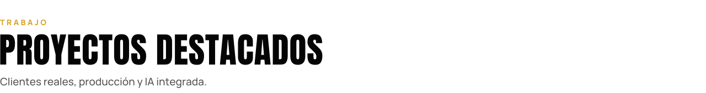
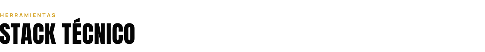
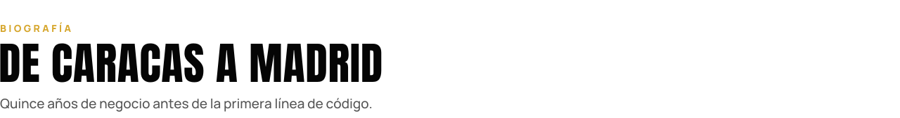
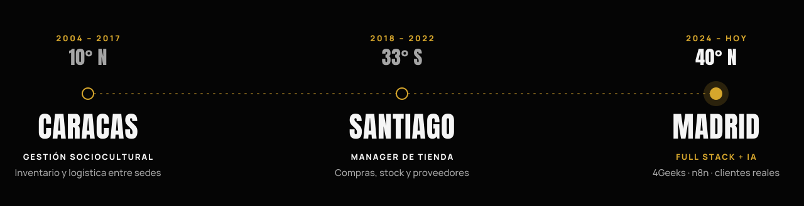
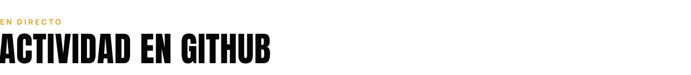
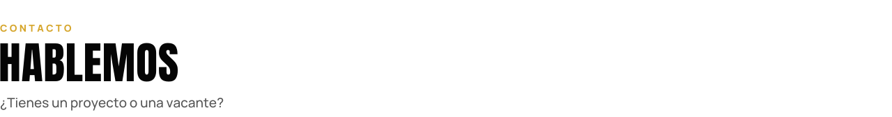
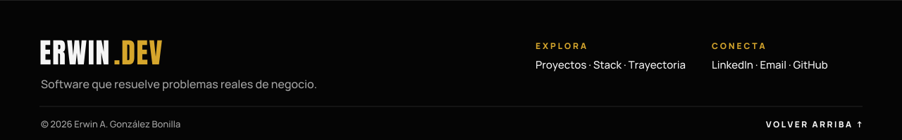

<!-- Diseño inspirado en kevinalvamusic.com · negro #050505 · oro #D6A62C · Anton + Manrope -->
<a id="inicio"></a>

<p align="center">
  
</p>

<p align="center">
  <a href="#proyectos"></a>
  <a href="https://www.linkedin.com/in/erwingonzalezbonilla"></a>
  <a href="mailto:alexcultural@gmail.com"></a>
  <a href="https://www.kevinalvamusic.com"></a>
</p>

<p align="center">
  
  
  
  
</p>

<p align="center">
  
</p>

<br/>

<!-- ============ SOBRE MÍ ============ -->
<picture>
  <source media="(prefers-color-scheme: dark)" srcset="assets/sec-sobre-mi-dark.svg"/>
  
</picture>

Construyo aplicaciones web con **React y Python** y les integro **IA**: chatbots con la API de OpenAI, agentes y flujos automatizados con **n8n**.

Antes de programar pasé **más de 15 años gestionando inventario, compras, proveedores y equipos** en Venezuela y Chile. Por eso diseño software pensando en cómo trabaja de verdad un negocio, no solo en cómo se ve.

<table>
  <tr>
    <td width="25%" valign="top"><sub><b>🧠 INTELIGENCIA ARTIFICIAL</b></sub><br/><sub>Chatbots y asistentes con OpenAI, Claude y Gemini</sub></td>
    <td width="25%" valign="top"><sub><b>⚙️ AUTOMATIZACIÓN</b></sub><br/><sub>Agentes y flujos con n8n y Make</sub></td>
    <td width="25%" valign="top"><sub><b>💻 DESARROLLO WEB</b></sub><br/><sub>React, Vite, HTML, CSS y JavaScript</sub></td>
    <td width="25%" valign="top"><sub><b>🗄️ APIS Y DATOS</b></sub><br/><sub>FastAPI, Flask, Node y PostgreSQL</sub></td>
  </tr>
</table>

```python
class Erwin:
    rol        = "Full Stack Developer · IA y Automatización"
    base       = "Madrid, España (abierto a remoto)"
    formacion  = ["Full Stack · 4Geeks Academy (2025)",
                  "Agentes de IA y n8n (2026)",
                  "AWS Cloud Practitioner (en preparación)"]
    superpoder = "15+ años en compras, stock y proveedores antes de escribir código"
    busco      = "Mi primer rol como developer"
```

<p align="center"></p>

<!-- ============ PROYECTOS ============ -->
<a id="proyectos"></a>
<picture>
  <source media="(prefers-color-scheme: dark)" srcset="assets/sec-proyectos-dark.svg"/>
  
</picture>

<table>
<tr>
<td colspan="2" valign="top">

<sub><b>NUEVO · SAAS · 2026</b></sub>

### 📦 [MYSTOCK](https://github.com/ErwinGonzalezBonilla/MyStock) &nbsp; 

> **Plataforma SaaS multiempresa** para que pequeños negocios gestionen inventario, punto de venta, compras, ventas, clientes y proveedores desde un solo sitio, con un **asistente de IA** que sugiere qué reponer.

| Arquitectura | Seguridad | Producto | Origen |
|:---|:---|:---|:---|
| React → FastAPI → SQLAlchemy → PostgreSQL → IA → n8n | Multi-tenant con JWT | Docs, roadmap, changelog y guía de contribución | Años gestionando el stock de una tienda |

    

<a href="https://github.com/ErwinGonzalezBonilla/MyStock"></a>

</td>
</tr>
<tr>
<td width="50%" valign="top">

<sub><b>CLIENTE REAL · EN PRODUCCIÓN</b></sub>

### 🎤 [KEVIN ALVA · WEB Y ENTRADAS](https://github.com/ErwinGonzalezBonilla/kevin-alva-web)

Web oficial de un artista musical con agenda, discografía, Spotify, YouTube y **venta de entradas**:

💳 Pago con **Stripe** → 🎟️ entrada con **QR firmado (HMAC-SHA256)** → 📱 validación en puerta con la cámara del móvil.

     

<a href="https://www.kevinalvamusic.com"></a>
<a href="https://github.com/ErwinGonzalezBonilla/kevin-alva-web"></a>

</td>
<td width="50%" valign="top">

<sub><b>CLIENTE REAL · IA · ENTREGADO</b></sub>

### 🎈 [BALLONETTE](https://github.com/ErwinGonzalezBonilla/ballonette-react)

Web para una empresa de decoración de eventos en Madrid:

🖼️ Galería por categorías con rutas dinámicas<br/>
🛠️ **Panel de administración** que sube fotos a **Cloudinary**<br/>
🤖 **BalloonBot**, chatbot con OpenAI que atiende a los clientes

    

<a href="https://ballonette-react.vercel.app"></a>
<a href="https://github.com/ErwinGonzalezBonilla/ballonette-react"></a>

</td>
</tr>
<tr>
<td width="50%" valign="top">

<sub><b>EQUIPO · 411 COMMITS · TERMINADO</b></sub>

### 🐾 [PATITAS CLUB](https://github.com/4GeeksAcademy/PatitasClub)

E-commerce de productos para mascotas, proyecto final del bootcamp:

⚛️ Frontend en React · 🐍 **API REST en Flask**<br/>
🔐 Login con **JWT** · 🗃️ Modelos con SQLAlchemy<br/>
💳 **Pagos con Stripe** · 🤝 Ramas, PRs e issues en equipo

    

<a href="https://github.com/4GeeksAcademy/PatitasClub"></a>

</td>
<td width="50%" valign="top">

<sub><b>USO PÚBLICO · ES/EN · ONLINE</b></sub>

### 💌 [GENERADOR DE INVITACIONES](https://github.com/ErwinGonzalezBonilla/generador-invitaciones)

Convertí una invitación hecha para un cliente en una **herramienta pública**:

✍️ Rellenas los datos → 👀 vista previa en directo → 📲 compartes por WhatsApp.<br/>
⚡ **Sin backend**: toda la invitación viaja en la URL.

   

<a href="https://generador-invitaciones.vercel.app"></a>
<a href="https://github.com/ErwinGonzalezBonilla/generador-invitaciones"></a>

</td>
</tr>
<tr>
<td colspan="2" valign="top">

<sub><b>CLIENTE REAL · IA · EN DESARROLLO</b></sub>

### 🐶 DON DOG · TIENDA ONLINE

Tienda online para un pet shop: catálogo con filtros, carrito y checkout, **panel de administración con control de stock y pedidos** y **"El Don"** 🤖, un asistente de IA que recomienda productos según la mascota y lo que hay en stock.

</td>
</tr>
</table>

<p align="center"></p>

<!-- ============ STACK ============ -->
<a id="stack"></a>
<picture>
  <source media="(prefers-color-scheme: dark)" srcset="assets/sec-stack-dark.svg"/>
  
</picture>

<table>
  <tr>
    <td><sub><b>FRONTEND</b></sub></td>
    <td></td>
  </tr>
  <tr>
    <td><sub><b>BACKEND</b></sub></td>
    <td></td>
  </tr>
  <tr>
    <td><sub><b>DATOS</b></sub></td>
    <td></td>
  </tr>
  <tr>
    <td><sub><b>HERRAMIENTAS</b></sub></td>
    <td></td>
  </tr>
  <tr>
    <td><sub><b>IA Y AUTOMATIZACIÓN</b></sub></td>
    <td>
      
      
      
      
      
    </td>
  </tr>
  <tr>
    <td><sub><b>SERVICIOS</b></sub></td>
    <td>
      
      
    </td>
  </tr>
</table>

<p align="center"></p>

<!-- ============ TRAYECTORIA ============ -->
<a id="trayectoria"></a>
<picture>
  <source media="(prefers-color-scheme: dark)" srcset="assets/sec-trayectoria-dark.svg"/>
  
</picture>

<p align="center">
  
</p>

<p align="center">
  
</p>

<p align="center"></p>

<!-- ============ ACTIVIDAD ============ -->
<picture>
  <source media="(prefers-color-scheme: dark)" srcset="assets/sec-actividad-dark.svg"/>
  
</picture>

<p align="center">
  
  
</p>

<p align="center">
  
</p>

<p align="center">
  
</p>

<p align="center"></p>

<!-- ============ AHORA MISMO ============ -->
<picture>
  <source media="(prefers-color-scheme: dark)" srcset="assets/sec-ahora-dark.svg"/>
  
</picture>

| | |
|:---|:---|
| <sub><b>LANZAMIENTO</b></sub> | Nueva web de **Kevin Alva** |
| <sub><b>EN CONSTRUCCIÓN</b></sub> | **MyStock**, paso a paso |
| <sub><b>CERTIFICACIÓN</b></sub> | **AWS Cloud Practitioner** |
| <sub><b>BUSCANDO</b></sub> | Mi **primer rol como developer** |

<p align="center"></p>

<!-- ============ CONTACTO ============ -->
<a id="contacto"></a>
<picture>
  <source media="(prefers-color-scheme: dark)" srcset="assets/sec-contacto-dark.svg"/>
  
</picture>

<p>
  <a href="https://www.linkedin.com/in/erwingonzalezbonilla"></a>
  <a href="mailto:alexcultural@gmail.com"></a>
</p>

<br/>

<a href="#inicio"></a>
