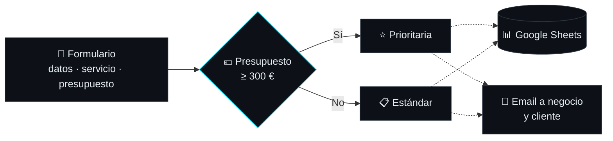

<!-- ════════════════════════ CABECERA ════════════════════════ -->
<p align="center">
  
</p>

<p align="center">
  
</p>

<p align="center">
  <a href="https://portafolio-erwin.vercel.app/"></a>
  <a href="https://www.linkedin.com/in/erwingonzalezbonilla"></a>
  <a href="mailto:alexcultural@gmail.com"></a>
  
</p>

<br/>

<!-- ════════════════════════ SOBRE MÍ ════════════════════════ -->
<table>
<tr>
<td width="58%" valign="top">

### Sobre mí

Durante **15+ años** gestioné inventario, compras, proveedores y equipos en Caracas, Santiago y Madrid. Hice a mano cientos de tareas que hoy sé automatizar.

Ahora construyo las herramientas que me habría gustado tener: **flujos con n8n**, **agentes y asistentes con IA** y **webs a medida** para negocios reales. Detecto dónde se pierde el tiempo en una operación y lo convierto en un prototipo funcional en días, no en meses.

**Busco:** rol de *AI Automation / AI Builder* en un equipo que quiera mover rápido. Presencial en Madrid o remoto.

</td>
<td width="42%" valign="top">

```ts
const erwin = {
  base:      "Madrid · presencial o remoto",
  foco:      ["n8n", "agentes de IA", "React", "Python"],
  día_a_día: ["Claude", "Claude Code", "ChatGPT", "OpenAI API"],
  idiomas:   { es: "nativo", en: "B1" },
  formación: "4Geeks Academy · Full Stack (2025)",
  próximo:   "AWS Cloud Practitioner",
  estado:    "disponible ✔",
};
```

</td>
</tr>
</table>

<!-- ════════════════════════ CIFRAS ════════════════════════ -->
<table align="center">
  <tr>
    <td align="center" width="190"><h2>15+</h2><sub>AÑOS EN NEGOCIOS<br/>REALES</sub></td>
    <td align="center" width="190"><h2>4</h2><sub>WEBS PARA<br/>CLIENTES</sub></td>
    <td align="center" width="190"><h2>3</h2><sub>PROYECTOS<br/>CON IA</sub></td>
    <td align="center" width="190"><h2>411</h2><sub>COMMITS EN<br/>EQUIPO</sub></td>
  </tr>
</table>

<br/>

<!-- ════════════════════════ SERVICIOS ════════════════════════ -->
## Qué hago

<table>
<tr>
<td width="33%" valign="top">

#### ⚡ Automatización
Flujos con **n8n** y **Make** que conectan formularios, hojas de cálculo, email y APIs, con reglas de negocio y ramas condicionales.

<sub>`recibir → clasificar → registrar → notificar`</sub>

</td>
<td width="33%" valign="top">

#### 🧠 IA aplicada
Agentes y asistentes con **Claude**, **OpenAI** y **Gemini** que atienden clientes, recomiendan productos y sugieren decisiones con datos reales.

<sub>`agentes · prompt engineering · APIs`</sub>

</td>
<td width="33%" valign="top">

#### 🌐 Webs y e-commerce
Webs, tiendas online y paneles con **React** y **Python**, con pagos con **Stripe**, gestión de stock y despliegue en Vercel.

<sub>`React · FastAPI · Flask · Stripe`</sub>

</td>
</tr>
</table>

<p align="center"><sub><b>CÓMO TRABAJO</b> &nbsp;·&nbsp; detectar el cuello de botella → prototipo funcional en días → medir → iterar</sub></p>

<br/>

<!-- ════════════════════════ PROYECTO DESTACADO ════════════════════════ -->
## Proyecto destacado

### [Automatización de solicitudes de clientes](https://github.com/ErwinGonzalezBonilla/n8n-gestion-solicitudes-clientes)

   

Un flujo en **n8n** que elimina el trabajo manual de recibir, revisar y organizar las solicitudes de clientes.



<sub>Línea continua: funcionando y probado con datos de prueba · Línea punteada: integración en curso</sub>

| Objetivo | Cómo | Estado |
|:---|:---|:---|
| Menos trabajo manual al gestionar solicitudes | Nodo **IF** con regla de negocio por presupuesto (≥ 300 €) | ✅ Validado con datos de prueba |
| Un registro central | **Google Sheets** como base de datos de solicitudes | 🔧 Integración en curso |
| Respuesta inmediata | **Email automático** al negocio y al cliente | 🔧 Integración y pruebas end-to-end |

<br/>

<!-- ════════════════════════ PROYECTOS ════════════════════════ -->
## Proyectos

<table>
<tr>
<td colspan="2" valign="top">

### 📦 [MyStock](https://github.com/ErwinGonzalezBonilla/MyStock) &nbsp;

El software que me habría gustado tener en la tienda: **inventario, punto de venta, compras, clientes y proveedores** en un solo sitio. Incluye un **asistente de IA** que sugiere qué reponer y **automatizaciones con n8n** para las tareas repetitivas.

<sub>**Arquitectura** React → FastAPI → PostgreSQL → IA → n8n &nbsp;·&nbsp; **Seguridad** multi-tenant con JWT &nbsp;·&nbsp; **Producto** docs, roadmap y changelog</sub>

    

</td>
</tr>
<tr>
<td width="50%" valign="top">

### 🎤 [Kevin Alva](https://github.com/ErwinGonzalezBonilla/kevin-alva-web)
 

Web de artista con **venta de entradas automatizada**: pago con Stripe → QR firmado (HMAC-SHA256) → validación en puerta.

  

**[Ver web →](https://www.kevinalvamusic.com)**

</td>
<td width="50%" valign="top">

### 🎈 [Ballonette](https://github.com/ErwinGonzalezBonilla/ballonette-react)
 

Web de eventos con galería, panel de administración y **BalloonBot**, un asistente con OpenAI que atiende a los clientes.

  

**[Ver web →](https://ballonette.com)**

</td>
</tr>
<tr>
<td width="50%" valign="top">

### 🐶 Don Dog · Tienda online
 

Tienda para un pet shop con catálogo, carrito, **control de stock y pedidos**, y el bot **"El Don"**, que recomienda productos según la mascota y el stock disponible.

</td>
<td width="50%" valign="top">

### 💌 [Invitaciones](https://github.com/ErwinGonzalezBonilla/generador-invitaciones)
 

Rellenas → vista previa → envío por WhatsApp. **Sin backend:** toda la invitación viaja en la URL.

  

**[Crear invitación →](https://generador-invitaciones.vercel.app)**

</td>
</tr>
<tr>
<td colspan="2" valign="top">

### 🐾 [Patitas Club](https://github.com/4GeeksAcademy/PatitasClub) &nbsp; 

E-commerce para mascotas con API REST en Flask, login con JWT y pagos con Stripe. Proyecto final en equipo en 4Geeks Academy.

   

</td>
</tr>
</table>

<br/>

<!-- ════════════════════════ STACK ════════════════════════ -->
## Stack

| | |
|:---|:---|
| **Automatización** |     |
| **IA** |    |
| **Frontend** |  |
| **Backend** |  |
| **Datos** |  |
| **Herramientas** |  |
| **Servicios** |    |

<br/>

<!-- ════════════════════════ TRAYECTORIA ════════════════════════ -->
## Trayectoria

<table>
<tr>
<td width="33%" valign="top">

**ANTES**<br/>
<sub>Caracas 🇻🇪 → Santiago 🇨🇱</sub>

15+ años en inventario, compras, proveedores y equipos. Entiendo cómo funciona un negocio por dentro y dónde se pierde el tiempo.

</td>
<td width="33%" valign="top">

**AHORA**<br/>
<sub>Madrid 🇪🇸 · 2025 →</sub>

Formación Full Stack en 4Geeks Academy. Automatizo con **n8n**, integro **IA** y construyo webs para clientes reales.

</td>
<td width="33%" valign="top">

**PRÓXIMO**<br/>
<sub>En curso</sub>

Primer rol en automatización o desarrollo. Preparando **AWS Cloud Practitioner**.

`███████░░░ 70%`

</td>
</tr>
</table>

<br/>

<!-- ════════════════════════ ACTIVIDAD ════════════════════════ -->
## Actividad en GitHub

<p align="center">
  
  
</p>

<p align="center">
  
</p>

<br/>

<!-- ════════════════════════ CONTACTO ════════════════════════ -->
<p align="center">
  <b>¿Tienes un proceso que se repite cada día?</b><br/>
  <sub>Probablemente se puede automatizar. Hablemos.</sub>
  <br/><br/>
  <a href="https://www.linkedin.com/in/erwingonzalezbonilla"></a>
  <a href="mailto:alexcultural@gmail.com"></a>
  <a href="https://portafolio-erwin.vercel.app/"></a>
</p>


