<!-- ═══════════════ CABECERA ═══════════════ -->


<p align="center">
  
</p>

<p align="center">
  <a href="https://portafolio-erwin.vercel.app/"></a>
  <a href="https://www.linkedin.com/in/erwingonzalezbonilla"></a>
  <a href="mailto:alexcultural@gmail.com"></a>
  <a href="https://www.kevinalvamusic.com"></a>
  
</p>

<!-- ═══════════════ FICHA DEL ROBOT ═══════════════ -->
<table align="center">
<tr>
<td width="38%" align="center">
  
</td>
<td width="62%" valign="middle">

```yaml
unidad:     ERWIN-01
modelo:     Full Stack Developer · IA y Automatización
base:       Madrid, España 🇪🇸  (remoto ✔)
estado:     🟢 ONLINE · disponible para trabajar
portafolio: portafolio-erwin.vercel.app
idiomas:    [español: nativo, inglés: B1]
experiencia_previa:
  - 15+ años en inventario, compras y proveedores
  - Caracas 🇻🇪 → Santiago 🇨🇱 → Madrid 🇪🇸
mision:     "Software que resuelve problemas reales de negocio"
```

</td>
</tr>
</table>

<!-- ═══════════════ PANEL DE SISTEMA ═══════════════ -->
<table align="center">
  <tr>
    <td align="center" width="170">🔋<br/><h3>15+</h3><sub>AÑOS EN<br/>NEGOCIOS REALES</sub></td>
    <td align="center" width="170">🛰️<br/><h3>4</h3><sub>WEBS PARA<br/>CLIENTES</sub></td>
    <td align="center" width="170">🧠<br/><h3>3</h3><sub>PROYECTOS<br/>CON IA</sub></td>
    <td align="center" width="170">⚙️<br/><h3>411</h3><sub>COMMITS<br/>EN EQUIPO</sub></td>
  </tr>
</table>


##  Registro de actualizaciones

<table>
<tr>
<td width="33%" valign="top" align="center">

### 🏪 v1.0
**ANTES**

<sub>15+ años gestionando inventario, compras, proveedores y equipos en Caracas y Santiago. Calibrado con datos reales de negocio.</sub>

</td>
<td width="33%" valign="top" align="center">

### 🤖 v2.0
**AHORA**

<sub>Construyo webs con React y Python, les integro IA y automatizo procesos con n8n. Instalado en 4Geeks Academy (2025).</sub>

</td>
<td width="33%" valign="top" align="center">

### 🚀 v3.0
**PRÓXIMO**

<sub>Objetivo: <b>primer rol como developer</b>.<br/>Descargando AWS Cloud Practitioner…</sub><br/>
`▓▓▓▓▓▓▓░░░ 70%`

</td>
</tr>
</table>


##  Misiones

<table>
<tr>
<td colspan="2" valign="top">

### 📦 [MyStock](https://github.com/ErwinGonzalezBonilla/MyStock) &nbsp;  

> El software que me habría gustado tener en la tienda: **inventario, punto de venta, compras, clientes y proveedores** en un solo sitio, con un 🤖 **asistente de IA** que sugiere qué reponer.

| 🏗️ Arquitectura | 🔐 Seguridad | 📚 Producto |
|:---|:---|:---|
| React → FastAPI → PostgreSQL → IA → n8n | Multi-tenant con JWT | Docs, roadmap y changelog |

    

</td>
</tr>
<tr>
<td width="50%" valign="top">

### 🎤 [Kevin Alva](https://github.com/ErwinGonzalezBonilla/kevin-alva-web)
 

Web de artista con **venta de entradas**:\
💳 Stripe → 🎟️ QR firmado (HMAC-SHA256) → 📱 validación en puerta.

   

[🌐 **Ver web →**](https://www.kevinalvamusic.com)

</td>
<td width="50%" valign="top">

### 🎈 [Ballonette](https://github.com/ErwinGonzalezBonilla/ballonette-react)
 

Web de eventos con 🖼️ galería, 🛠️ panel de administración y el bot 🤖 **BalloonBot**, que atiende a los clientes con OpenAI.

   

[🌐 **Ver web →**](https://ballonette.com)

</td>
</tr>
<tr>
<td width="50%" valign="top">

### 🐾 [Patitas Club](https://github.com/4GeeksAcademy/PatitasClub)
 

E-commerce para mascotas con API REST en Flask, 🔐 login con JWT y 💳 pagos con Stripe.

   

</td>
<td width="50%" valign="top">

### 💌 [Invitaciones](https://github.com/ErwinGonzalezBonilla/generador-invitaciones)
 

✍️ Rellenas → 👀 vista previa → 📲 WhatsApp.\
⚡ **Sin backend**: toda la invitación viaja en la URL.

  

[🌐 **Crear invitación →**](https://generador-invitaciones.vercel.app)

</td>
</tr>
<tr>
<td colspan="2" valign="top">

### 🐶 Don Dog · Tienda online &nbsp;  

Tienda para un pet shop con catálogo, carrito, 📊 **control de stock y pedidos**, y el bot 🤖 **"El Don"**, que recomienda productos según la mascota y lo que hay en stock.

</td>
</tr>
</table>


##  Componentes instalados

<table align="center">
  <tr>
    <td align="center"><b>🎨 Interfaz</b></td>
    <td></td>
  </tr>
  <tr>
    <td align="center"><b>⚙️ Motor</b></td>
    <td></td>
  </tr>
  <tr>
    <td align="center"><b>💾 Memoria</b></td>
    <td></td>
  </tr>
  <tr>
    <td align="center"><b>🔧 Herramientas</b></td>
    <td></td>
  </tr>
  <tr>
    <td align="center"><b>🧠 Núcleo IA</b></td>
    <td>
      
      
      
      
      
    </td>
  </tr>
  <tr>
    <td align="center"><b>🔌 Servicios</b></td>
    <td>
      
      
    </td>
  </tr>
</table>


##  Telemetría

<p align="center">
  
  
</p>

<p align="center">
  
</p>


<p align="center">
  <br/>
  <b>📡 TRANSMISIÓN ABIERTA</b><br/>
  <i>¿Tienes un proyecto o una vacante? Recibo señal.</i><br/><br/>
  <a href="https://www.linkedin.com/in/erwingonzalezbonilla"></a>
  <a href="mailto:alexcultural@gmail.com"></a>
  <a href="https://portafolio-erwin.vercel.app/"></a>
</p>


